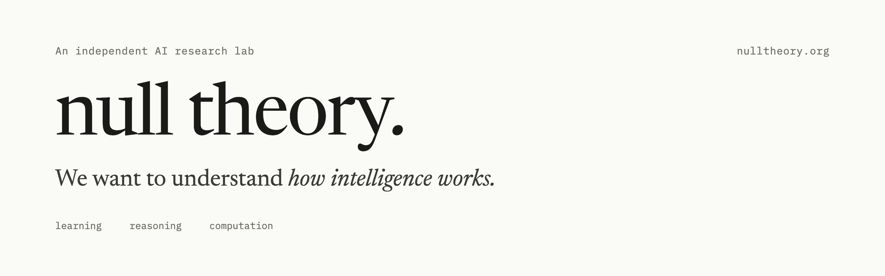

# null theory.

Null Theory is an independent AI research lab studying the foundations of learning, reasoning, and computation. We work through mathematics, experiments, and working code.

### Our central question

> Can a parameterized quantum circuit learn context-dependent next-token distributions with better parameter efficiency or computational scaling than a comparably sized classical model?

To test it directly, we're building three pieces:

| Component | Role | Status |
| --- | --- | --- |
| **Quantum simulator** | State-vector simulator in Rust that runs the circuits | In progress |
| **aaronnet** | From-scratch CPU autograd engine for the classical baselines | Benchmarked against PyTorch |
| **Transformer** | Small causal transformer on aaronnet, the model we compare against | Plan |

### What we study

- **Learning and representation** — how neural networks organize information, and how architecture shapes what they learn.
- **Reasoning and generalization** — why models succeed at some problems and fail at others.
- **Foundations of computation** — classical and quantum systems, and the mathematical limits of each.

### An open record

We publish questions, methods, and limitations as the work happens, not just conclusions. Every notebook entry is labeled **Plan**, **In progress**, or **Result**.

[Research](https://nulltheory.org/research.html) · [Notebook](https://nulltheory.org/writing.html) · [About](https://nulltheory.org/about.html) · [Work with us](https://nulltheory.org/work-with-us.html) · research@nulltheory.org
